# Realism on Seedance

**Skills for directing Seedance toward realism, learned building a video engine on it.**

<a href="engine/remix.md">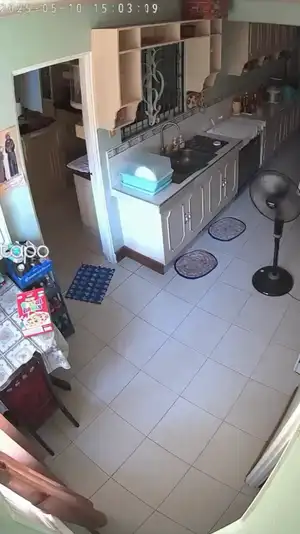</a>

Seedance is a strong video model with habits. Ask it for a place and it invents one. Ask it for CCTV and it draws its idea of CCTV. Hand it several references and it reads them as one set.

This engine was built by learning those habits on Seedance 2.0 and carrying them to 2.5. Each habit has a skill that answers it. Together they make one way of working: find the real world first, write the scene to it, and hand Seedance both.

Each skill is a real skill file. Give one to your agent and it will write Seedance prompts the same way. Every example is a finished video from the engine, shown with the photograph it was given and the lines it was written, and no clip is used twice. [All the clips](#all-clips) are gathered at the end.

**To use a skill:** copy its folder into your agent's skills folder (for Claude Code, `~/.claude/skills/`).

**Your own keys.** Nothing runs through this repository and nothing is stored in it. Your agent brings an Openverse client for the free photo library, an Apify token for the paid image searches, and a key from any provider that serves Seedance with reference images. [bring-your-own-keys](skills/bring-your-own-keys/SKILL.md) says where each is used.

## The skills

### Before you start

| | Skill | Use it when |
| --- | --- | --- |
| | [**bring-your-own-keys**](skills/bring-your-own-keys/SKILL.md) | Running any of this for real. Your Openverse client, your Apify token, your video API key: where each is used and how each is called. |

### Seeing

| | Skill | Use it when |
| --- | --- | --- |
|  | [**catch-it-on-a-device**](skills/catch-it-on-a-device/SKILL.md) | The request names a camera: CCTV, a doorbell, a trail cam, a dashcam, a bodycam. |
| 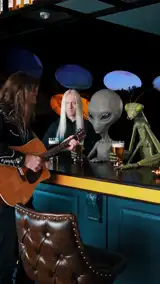 | [**find-the-place-first**](skills/find-the-place-first/SKILL.md) | Always. Find a real photograph of the place before writing anything, then write the scene to what is in it. |
| 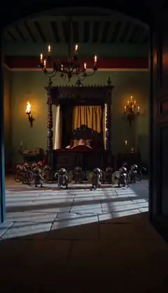 | [**night-shots**](skills/night-shots/SKILL.md) | The video is at night. A subject photographed in the dark is a silhouette, which Seedance can't animate. Unless the camera has its own light (a flash, infrared, headlights), find the empty place and write the subject in. |

### Worlds

| | Skill | Use it when |
| --- | --- | --- |
| 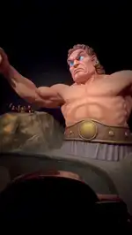 | [**world-building-and-appropriation**](skills/world-building-and-appropriation/SKILL.md) | The request names a work, a film, a myth or a venue. Its world becomes the ground. |
| 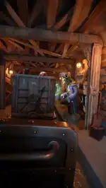 | &emsp;↳ [ride-it](skills/world-building-and-appropriation/SKILL.md#rides) | Part of world-building-and-appropriation, not a skill of its own. The request names a ride. The seat is the opening frame, and the work's things are placed along the track. |
|  | [**swap-the-stand-in**](skills/swap-the-stand-in/SKILL.md) | The photograph already has someone where the subject should be. |
| 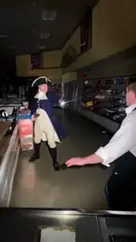 | [**sort-the-characters**](skills/sort-the-characters/SKILL.md) | The request names characters. Each is handled by what it is: a meme has its photo found, a figure from myth, folklore or an old book is named and described, a celebrity is declined, an owned character is declined unless it has a plain guise to write instead, and anyone else is described. |

### Telling

| | Skill | Use it when |
| --- | --- | --- |
|  | [**observation-or-plot**](skills/observation-or-plot/SKILL.md) | Deciding whether the take is an observation (a view held, nothing has to happen) or a plot (an event with a payoff). |
| 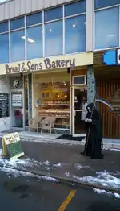 | ⭐ [**frame-zero**](skills/frame-zero/SKILL.md) | Every take. The photograph is the video's first frame: the first beat describes it as it is, with the subject already in it, and nothing it contradicts is asked for. |
|  | [**stamp-the-beats**](skills/stamp-the-beats/SKILL.md) | Every take. Each beat lands on its second. |
|  | [**one-bag-of-four**](skills/one-bag-of-four/SKILL.md) | Choosing references. Seedance reads them as one flat set. |

### Remix

A page about how the engine changes a finished video. It isn't a skill to install.

| | Page | What it covers |
| --- | --- | --- |
| 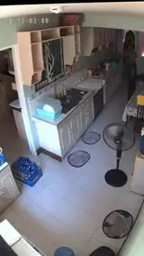 | [**Remix**](engine/remix.md) | A sentence that changes a finished video, and how deep the change goes. |

## All clips

<b>Open to see every clip</b>: nineteen finished videos, each linked to the page it is an example on.

 

| | | | |
| --- | --- | --- | --- |
| <a href="skills/catch-it-on-a-device/SKILL.md#the-oval-office-on-cctv">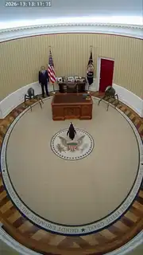</a> [The Oval Office on CCTV](skills/catch-it-on-a-device/SKILL.md#the-oval-office-on-cctv) catch-it-on-a-device | <a href="skills/catch-it-on-a-device/SKILL.md#a-doorbell-camera-on-a-patio">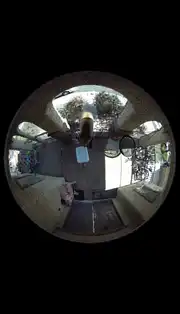</a> [A doorbell camera on a patio](skills/catch-it-on-a-device/SKILL.md#a-doorbell-camera-on-a-patio) catch-it-on-a-device | <a href="skills/find-the-place-first/SKILL.md#a-fox-in-a-real-kitchen">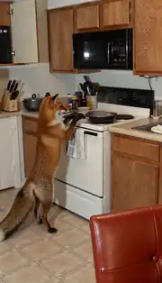</a> [A fox in a real kitchen](skills/find-the-place-first/SKILL.md#a-fox-in-a-real-kitchen) find-the-place-first | <a href="skills/night-shots/SKILL.md#a-badger-in-a-dark-yard">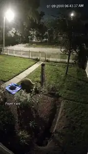</a> [A badger in a dark yard](skills/night-shots/SKILL.md#a-badger-in-a-dark-yard) night-shots |
| <a href="skills/night-shots/SKILL.md#a-moose-on-an-infrared-trail-camera">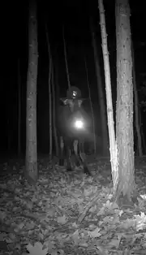</a> [A moose on an infrared trail camera](skills/night-shots/SKILL.md#a-moose-on-an-infrared-trail-camera) night-shots |  [The Odyssey ride](skills/world-building-and-appropriation/SKILL.md#the-odyssey-ride) world-building-and-appropriation | <a href="skills/world-building-and-appropriation/SKILL.md#a-haunted-cruise-ship-ride">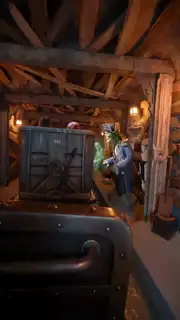</a> [A haunted cruise ship ride](skills/world-building-and-appropriation/SKILL.md#a-haunted-cruise-ship-ride) ride-it | <a href="skills/swap-the-stand-in/SKILL.md#same-photograph-two-scripts">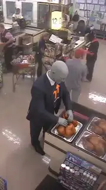</a> [Stonk, no stand-in](skills/swap-the-stand-in/SKILL.md#same-photograph-two-scripts) swap-the-stand-in |
| <a href="skills/swap-the-stand-in/SKILL.md#same-photograph-two-scripts">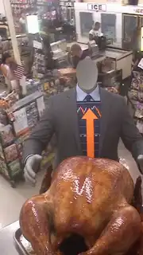</a> [Stonk, with a stand-in](skills/swap-the-stand-in/SKILL.md#same-photograph-two-scripts) swap-the-stand-in | <a href="skills/frame-zero/SKILL.md#the-grim-reaper-at-a-bakery">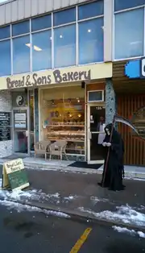</a> [The grim reaper at a bakery](skills/frame-zero/SKILL.md#the-grim-reaper-at-a-bakery) frame-zero | <a href="skills/sort-the-characters/SKILL.md#aisle-duel">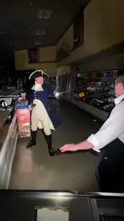</a> [Aisle Duel](skills/sort-the-characters/SKILL.md#aisle-duel) sort-the-characters | <a href="skills/observation-or-plot/SKILL.md#observation-two-memes-on-a-trail-camera">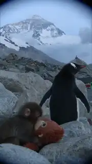</a> [Two memes on a trail camera](skills/observation-or-plot/SKILL.md#observation-two-memes-on-a-trail-camera) observation-or-plot |
| <a href="skills/observation-or-plot/SKILL.md#plot-zeus-at-a-fuse-box">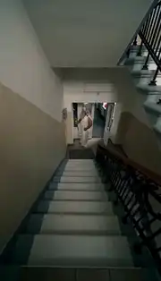</a> [Zeus at a fuse box](skills/observation-or-plot/SKILL.md#plot-zeus-at-a-fuse-box) observation-or-plot | <a href="skills/stamp-the-beats/SKILL.md#the-doorbell-raccoon">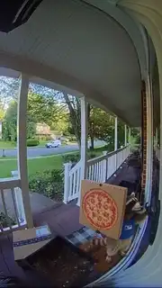</a> [The doorbell raccoon](skills/stamp-the-beats/SKILL.md#the-doorbell-raccoon) stamp-the-beats | <a href="skills/one-bag-of-four/SKILL.md#the-bar-in-the-ufo">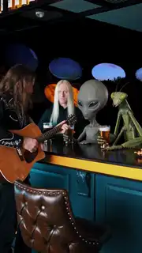</a> [The bar in the UFO](skills/one-bag-of-four/SKILL.md#the-bar-in-the-ufo) one-bag-of-four |  [The bear, before the remix](engine/remix.md#example-the-bear-becomes-a-t-rex) Remix |
| <a href="engine/remix.md#example-the-bear-becomes-a-t-rex">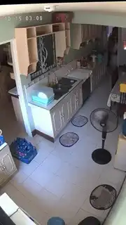</a> [The T-rex, after it](engine/remix.md#example-the-bear-becomes-a-t-rex) Remix | <a href="engine/remix.md#example-a-new-place-the-same-cast">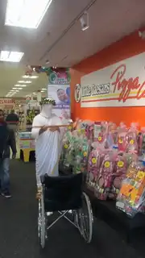</a> [The Lil Caesars mascot, before the remix](engine/remix.md#example-a-new-place-the-same-cast) Remix | <a href="engine/remix.md#example-a-new-place-the-same-cast">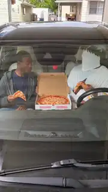</a> [The two of them in a car, after it](engine/remix.md#example-a-new-place-the-same-cast) Remix |  |

## Inside the engine

The modules here are the engine's own, the parts that carry out the skills above. The engine does not run from this repository: the orchestrator that chains them, the planner, the search scrapers and the gate rules stay private, with the payment, capacity and deployment code they are woven through.

| Layer | Files |
| --- | --- |
| Reading | `_search_intent.mjs` `_pregate.mjs` `entityResolve.mjs` `_prose_capable.mjs` `_look_change.mjs` `_ride.mjs` `forms.json` |
| Grounding | `_sourceability.mjs` `_query.mjs` `library.mjs` `_source_entity.mjs` `_ride_seat.mjs` `_ride_world.mjs` `_placeholder_card.mjs` `_plate_dressing.mjs` `_judge_*.mjs` `redact_any.mjs` `detect_prompt.txt` |
| Direction | `_frame_zero.mjs` `_ground_prompt.mjs` `_beat_law.mjs` `_beat_edit.mjs` `_writer_contract.mjs` `_ride_writer.mjs` `_swap_check.mjs` |
| Seedance | `_multiref_gen.mjs` `_leak_guard.mjs` |
| Remix | `_remix_intent.mjs` `_carry_reader.mjs` `_strip_choice.mjs` `_gen_state.mjs` |

Every decision the engine makes, drawn as a question and its arms: [the full circuitry](docs/circuitry.svg).

The commits are real, with their dates, from 2 August 2026. Removed files were taken out of every commit, and every message was set to one line.
