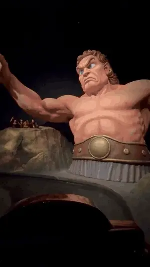
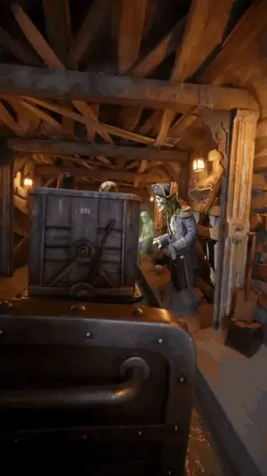
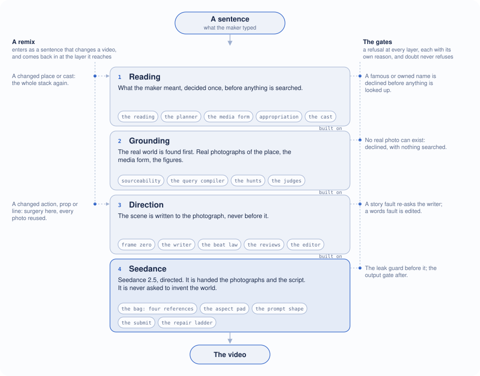
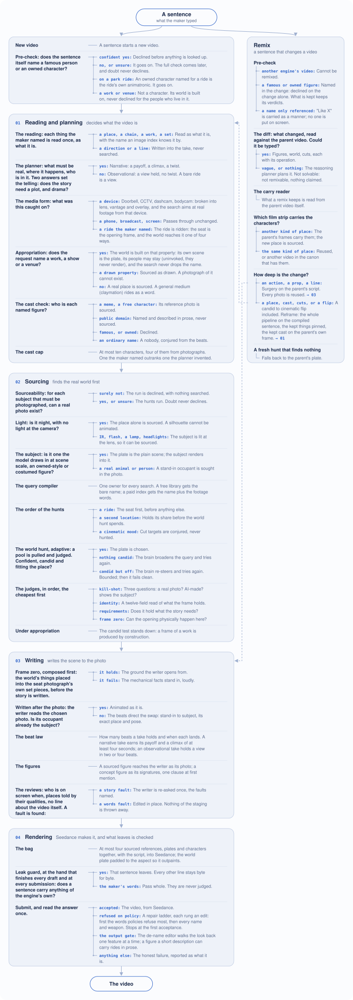

# Seedance tool – inspired by Sora

**A video engine built on realism. A Seedance adapter.**

Ask a video model for a place and it invents one. This engine never asks. It finds real photographs first (the place, the camera the video was "caught on", the figures), writes the scene to them, and hands Seedance both. The video looks caught because the ground under it was.

Built on Seedance 2.0, updated to 2.5. This repo is a showcase of the engine's parts, not an installable tool: payment, capacity and deployment code was removed.

## Two videos

<table>
<tr>
<td align="center" width="50%"></td>
<td align="center" width="50%"></td>
</tr>
<tr>
<td valign="top"><b>"The Odyssey ride"</b> Three words. The engine read the poem and found its things: the Sperlonga sculpture of Polyphemus, a Roman mosaic of Ulysses and the Sirens, a reconstructed Greek trireme. A real ride seat is the opening frame, and those things line the track.</td>
<td valign="top"><b>"A dark ride through a haunted cruise ship"</b> No work named, so a real dark-ride photograph carries the world. The captain, the waltzing skeletons and the ghost engineer have no real photo to find, so they're described from the script.</td>
</tr>
</table>

## How it works

A sentence goes in at the top and a video comes out at the bottom.

### 1. Reading

Decide once what the maker meant, before any search.

- **The camera.** A named device (CCTV, doorbell, dashcam, bodycam, trail cam) is searched as real footage from that device, so the angle, lens and overlay are right before anything is written.
- **The world.** A named film, work or venue becomes the ground. A named ride is ridden: the seat is the first frame.
- **The cast.** A meme's photo is found. A figure from myth is named. A celebrity or owned character is declined. Anyone else is described.
- **The story.** Plot (an event with a payoff) or observation (a view held).

### 2. Grounding

Find the real world first.

- Each subject is checked first: can a real photo of it exist? If it can't, nothing is searched.
- One module writes every search, in each index's own words.
- Cheap judges throw out more than half of the candidates first. The survivors are checked for whether the photo can hold the story.
- At night, with no light at the camera, only the empty place is found. A silhouette gives Seedance nothing to animate.

### 3. Direction

The scene is written to the photograph, never before it.

- The writer reads the chosen photo: what's there, and who stands where the subject should be. That person or animal becomes the subject.
- Each beat is stamped with its second.
- Reviews catch a figure on screen at the wrong time or a climax cut short, and send it back once.

### 4. Seedance

What the engine knows about Seedance:

- It reads all references as one flat set. At most four, and order doesn't matter.
- No camera words in the prompt. Seedance takes the camera from the photographs.
- A refusal is repaired a step at a time. Anything else is reported as the failure it is.

### Remix

A sentence that changes a finished video. A small change (an action, a prop, a line) edits the script and reuses every photo. A big one (a new place, cast or style) runs the engine again, keeping what stays.

## The full circuitry

## What is here

| Layer | Files |
| --- | --- |
| Reading | `_search_intent.mjs` `_pregate.mjs` `entityResolve.mjs` `_prose_capable.mjs` `_look_change.mjs` `_ride.mjs` `forms.json` |
| Grounding | `_sourceability.mjs` `_query.mjs` `library.mjs` `_source_entity.mjs` `_ride_seat.mjs` `_ride_world.mjs` `_placeholder_card.mjs` `_plate_dressing.mjs` `_judge_*.mjs` `redact_any.mjs` `detect_prompt.txt` |
| Direction | `_frame_zero.mjs` `_ground_prompt.mjs` `_beat_law.mjs` `_beat_edit.mjs` `_writer_contract.mjs` `_ride_writer.mjs` `_swap_check.mjs` |
| Seedance | `_multiref_gen.mjs` `_leak_guard.mjs` |
| Remix | `_remix_intent.mjs` `_carry_reader.mjs` `_strip_choice.mjs` `_gen_state.mjs` |

The commits are real, daily from 2 August 2026. Removed files were taken out of every commit, and every message was set to one line.
