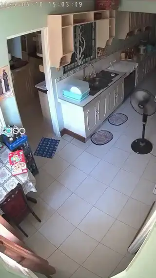
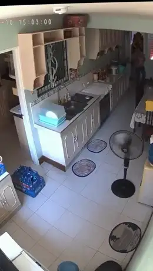
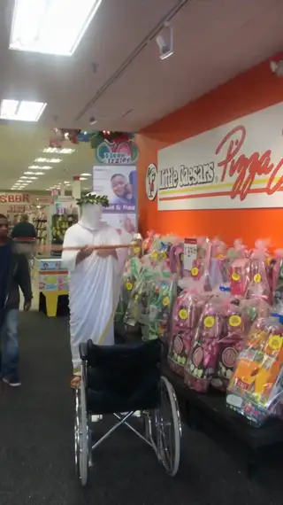
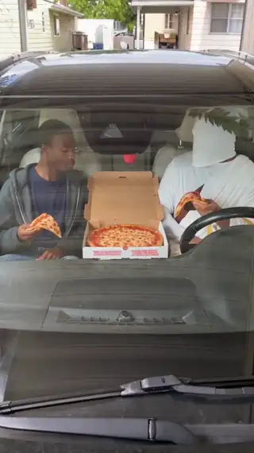
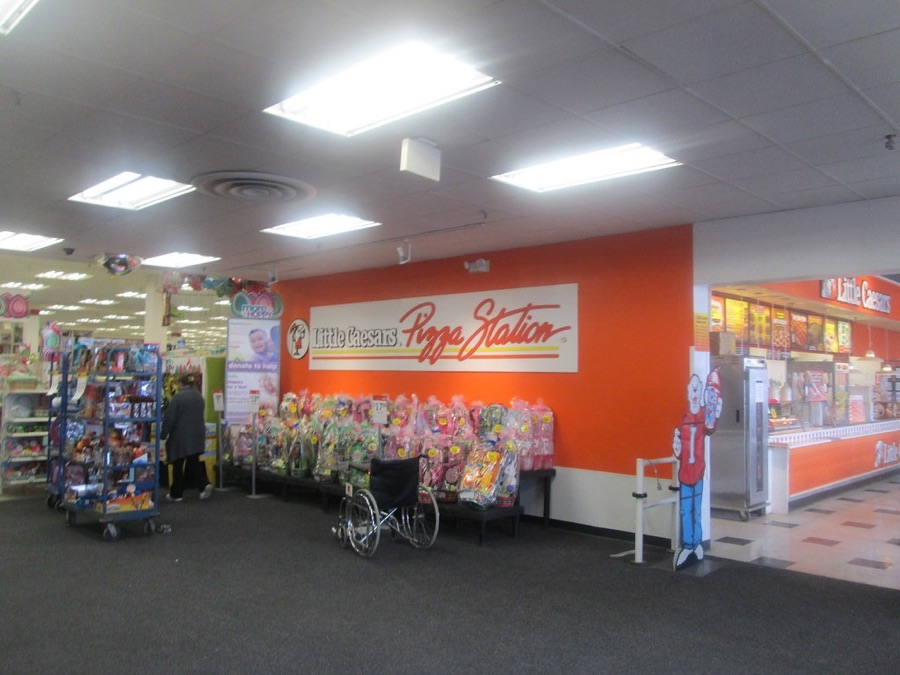
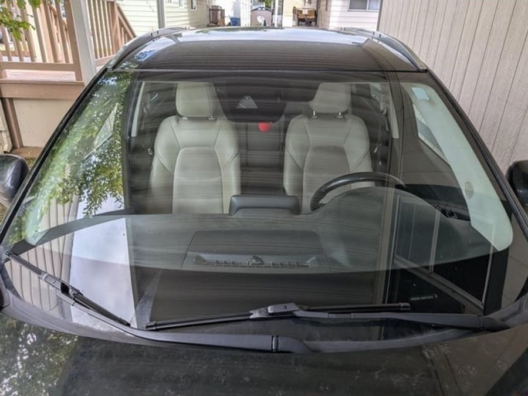
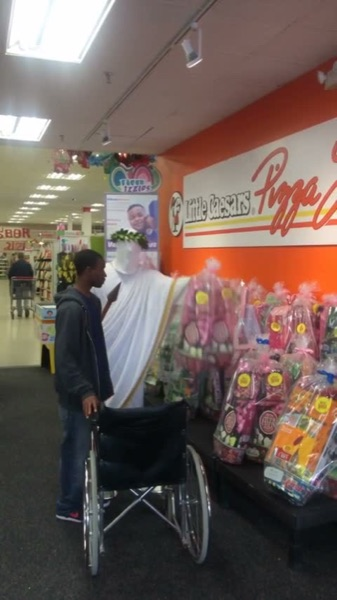

[← Back to the skills](../README.md)

# Remix

*A page about the engine, not a skill to install.*

A remix is a sentence that changes a finished video. The engine reads what the sentence changes against the parent video, decides how deep the change goes, and comes back in at the layer that change reaches. Everything the sentence doesn't touch is kept, read from the parent itself rather than assumed.

## Example: the bear becomes a T-rex

| Parent | Remix |
| --- | --- |
| *"cctv footage of a bear chasing a man for his cereal. the bear ends up grabbing the cereal and sees the camera and starts celebrating with tiktok dances"* | *"Its a T-rex instead of a bear and the man running holds the cereal box while running then drops it"* |
| <a href="examples/bear.mp4"></a> | <a href="examples/trex.mp4"></a> |


The remix changed the figure and the action. The kitchen stayed: both videos were made from this same CCTV still.

## Example: a new place, the same cast

| The original | The remix |
| --- | --- |
| *"lil caesars mascot hanging out with a black hood dude. the black dude is melancholic about the times lil caesars was there for him with their affordable pricings and generous sizes"* | *"lil caesar and black dude in the car rapping lil caesar song"* |
| <a href="examples/lc.mp4"></a> | <a href="examples/lc-rap.mp4"></a> |
| <br>**Found:** a real Little Caesars pizza station inside a store, gift baskets and a wheelchair in front of it. |  <br>**Found:** a parked car seen through its windshield. **Carried:** a frame of the original, with both characters in it. |

The remix moved the two of them into a car. The car came from a new photograph. The cast came from the parent: a frame of the original rode along as a reference, and the script seats the two people from it in the car's front seats:

```
The two people from the second image sit in those seats, exactly as they look
there: the young Black man in the dark grey hoodie and blue jeans in the left
seat, and the person in the white toga and green laurel wreath with the white
mask behind the wheel on the right.
```

The mascot is never named. The original's script wrote it as "a Roman emperor with a laurel wreath, wearing a toga, holding a spear" (see [sort-the-characters](../skills/sort-the-characters/SKILL.md)).

## How deep a change goes

- **Surgery.** A new action, a prop or a line of dialogue is an edit to the parent's script. Every photograph is reused, and the opening frame's rules hold.
- **Reframe.** A new place, a new cast, new cuts, or a switch between candid and cinematic runs the whole engine again on a sentence compiled from the parent and the change. What is kept is pinned, and kept characters ride the parent's own frames. If a fresh search finds nothing, it falls back to the parent's photograph.

## Its own checks

- A video from another engine cannot be remixed.
- A figure named in the change is judged by the same rule as in a fresh request (see [sort-the-characters](../skills/sort-the-characters/SKILL.md)), on the change alone. Everything kept keeps its earlier verdicts.
- A name that is only referenced ("talks like X") is carried as a manner and puts no one on screen.
- A change the engine can't type (vague, empty, or words it had to drop) goes to a planner, whose plan is then checked by the same rules. If no plan works, nothing is claimed.

Code: [`_remix_intent.mjs`](../_remix_intent.mjs) · [`_carry_reader.mjs`](../_carry_reader.mjs) · [`_strip_choice.mjs`](../_strip_choice.mjs) · [`_gen_state.mjs`](../_gen_state.mjs)
