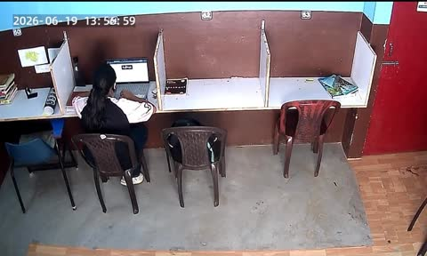
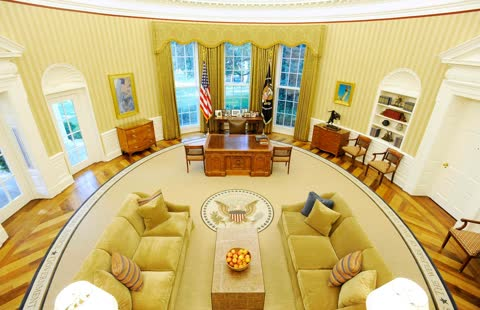
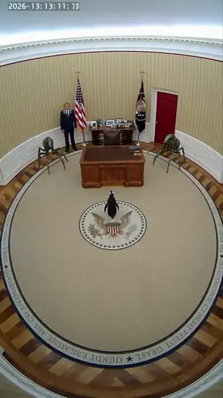
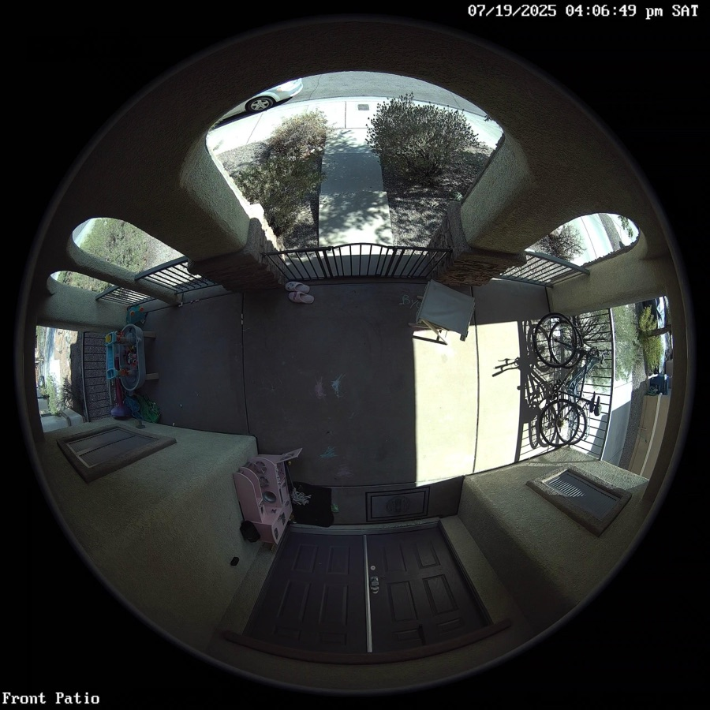
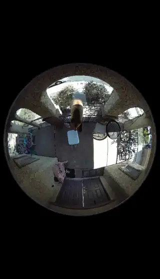

[← All skills](../../README.md)

# catch-it-on-a-device

Every device has its own way of seeing: a fixed corner high on a wall, a fisheye bent around a porch, a timestamp burned into the frame. Described in words, Seedance draws its idea of the device, and the camera floats. Handed a real still from one, it keeps the angle and the lens. The video looks caught because the frame it starts from was.

## Do this

1. **Break the device into its parts:** lens, vantage, overlay. CCTV is a high fixed angle looking down, grainy and low in colour, with a timestamp or camera label. A doorbell camera is a fisheye looking out from the door.
2. **Search the way the footage is posted.** A camera's generic name finds shop listings and installs. The words people title their footage with find the frame, like "front porch video doorbell footage" or "security camera footage of a kitchen". Device footage is on the open web, not in the free photo library, so search it on the paid routes or with your own web search (see [bring-your-own-keys](../bring-your-own-keys/SKILL.md)).
3. **Keep the overlay.** A timestamp or a camera label belongs to the footage. Don't reject a still for having one.
4. **Make sure the still holds the place.** When the request names a place the device never saw, like the Oval Office on CCTV, find the camera and the place separately. Then write the place into the camera's frame, piece by piece: what stands where. That is the move from [world-building-and-appropriation](../world-building-and-appropriation/SKILL.md): the named place's things are mapped onto the photograph.
5. **Write the event into the still.** Name the capture once at most, in the first beat ("CCTV footage shows…"). Add no shot words: no close-ups, pans or zooms. Seedance reads the camera from the still.
6. **At night, the device needs its own light** (see [night-shots](../night-shots/SKILL.md)).

## Examples

### The Oval Office on CCTV

*"cctv of the oval office. a penguin is trying to escape from two mantid beings and a tall nordic who guard the perimeter."*

| Found | Video |
| --- | --- |
| <br>**The camera.** A real office CCTV still: a high corner, a timestamp, flat washed colour.<br><br><br>**The place.** The Oval Office. | <a href="examples/oval.mp4"></a> |

The first beat, with the place written into the camera's frame (step 4):

```
[0s] From the fixed security camera high in the corner, its timestamp and
camera number in the corners of the frame and its flat washed colour over
everything: the Resolute Desk stands where the long study desk with white
cubicle dividers stood, yellow and cream striped wallpaper with white
wainscoting covers the wall where the brown paint and the blue upper section
were, an oval carpet with the Presidential Seal and a quote border lies where
the grey concrete floor was, [...] a tall nordic stands guard beside the desk
where the person at the laptop sat, two mantid beings stand at the far wall
on either side of the red door, and a penguin stands alone in the middle of
the seal carpet.
```

The video keeps the high corner and a timestamp, and the office's desk, carpet and walls are the Oval Office's.

### A doorbell camera on a patio

*"Doorbell camera catches a bear opening a cooler"*

| Found | Video |
| --- | --- |
| <br>**The camera.** A real doorbell still: the fisheye circle, a timestamp, the label "Front Patio". | <a href="examples/patio.mp4"></a> |

The script, as written:

```
[0s] A bear opens a cooler, grabs a sandwich, pauses as a man yells from
inside, then walks over and sits on the porch swing seat.
```

The video keeps the fisheye circle and the patio as the doorbell saw it.
