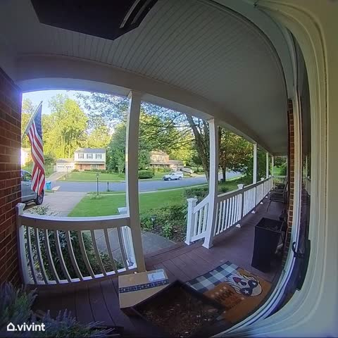
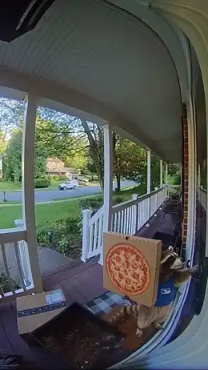

[← All skills](../../README.md)

# catch-it-on-a-device

Every device has its own way of seeing: a fixed corner high on a wall, a fisheye bent around a porch, a timestamp burned into the frame. Described in words, Seedance draws its idea of the device, and the camera floats. Handed a real still from one, it keeps the angle, the lens, the grain and the overlay. The video looks caught because the frame it starts from was.

## Do this

1. **Break the device into its parts:** lens, vantage, overlay. CCTV is a high fixed angle looking down, grainy and low in colour, with a timestamp or camera label. A bodycam is chest height, a wide lens, a battery and time bar.
2. **Search the way the footage is posted.** A camera's generic name finds shop listings and installs. The words people title their footage with find the frame. The searches behind the examples below: "security camera footage of a kitchen", "front porch video doorbell footage", "Mount Everest trailcam footage". When the subject is something the device never caught, search for something it does catch in that place and swap it later. For the penguin on Everest, that was "snow leopard Mount Everest trailcam footage".
3. **Keep the overlay.** A timestamp or a brand mark belongs to the footage. Don't reject a still for having one.
4. **Make sure the still holds the place.** When the request names a place the device never saw, like the Oval Office on CCTV, find the camera and the place separately. Then write the place into the camera's frame, piece by piece: what stands where. That is the move from [world-building-and-appropriation](../world-building-and-appropriation/SKILL.md): the named place's things are mapped onto the photograph in a `Set:` line.
5. **Write the event into the still.** Name the capture once at most, in the first beat ("CCTV footage shows…"). Add no shot words: no close-ups, pans or zooms. Seedance reads the camera from the still.
6. **At night, the device needs its own light,** such as infrared, a porch light or headlights. With none, Seedance gets a silhouette and invents the subject.

## Examples

Each shows the request, the still that was found, and the video Seedance made from it.

| Request | Still found | Video |
| --- | --- | --- |
| *"cctv footage of a bear chasing a man for his cereal…"* |  | <a href="examples/cctvbear.mp4"></a> |
| *"doorbell cam: a raccoon in a tiny delivery vest rings the bell…"* |  | <a href="examples/doorbell.mp4"></a> |
| *"cctv of the oval office. a penguin is trying to escape…"* |   | <a href="examples/oval.mp4"></a> |
| *"the nihilistic penguin and punch monkey on trailcam footage in everest-like mountains"* |  | <a href="examples/trail.mp4"></a> |

The first beat of each script, as written:

```
[0s] CCTV footage shows a man sprinting through a suburban kitchen, followed
closely by a large bear.
```

```
[0s] The raccoon stands at the right edge of the porch in a tiny delivery
vest, pizza box balanced against one arm, and presses the doorbell button.
```

The Oval Office, with the place written into the camera's frame (step 4):

```
[0s] From the fixed security camera high in the corner, its timestamp and
camera number in the corners of the frame and its flat washed colour over
everything: the Resolute Desk stands where the long study desk with white
cubicle dividers stood, yellow and cream striped wallpaper with white
wainscoting covers the wall where the brown paint and the blue upper section
were, an oval carpet with the Presidential Seal and a quote border lies where
the grey concrete floor was, [...] a tall nordic stands guard beside the desk
where the person at the laptop sat, two mantid beings stand at the far wall
on either side of the red door, and a penguin stands alone in the middle of
the seal carpet.
```
