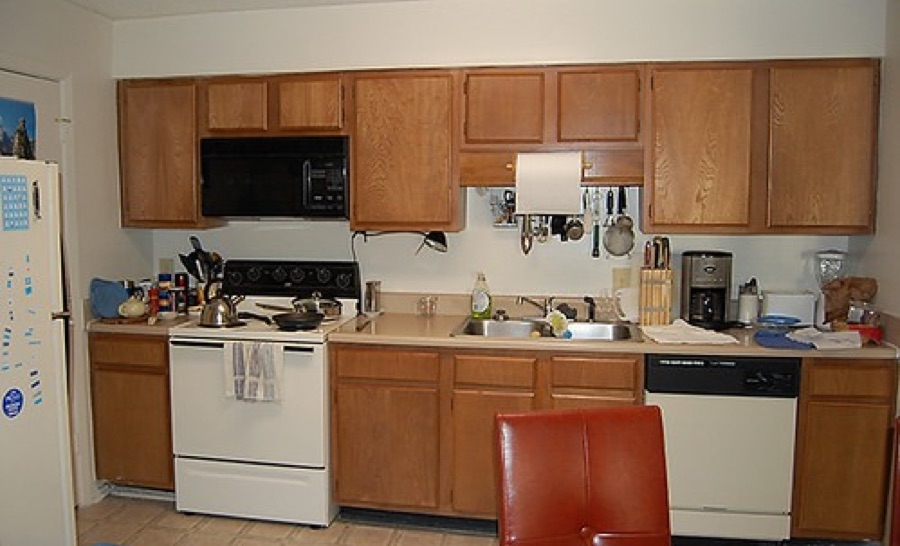
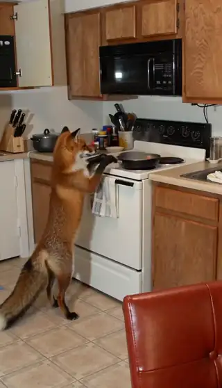

[← All skills](../../README.md)

# find-the-place-first

Ask Seedance for a place and it draws nobody's place: a kitchen that is every kitchen, a street that is a composite. Hand it a photograph of a real place and it keeps that place, its light, its clutter, where things stand. So the place is found first, and the scene is written to the photograph, never before it.

## Do this

1. **Read what place the request names,** in the maker's own words. A quality of the place ("dreamy", "abandoned") belongs in the search, because the photograph has to carry it. Never swap the maker's place for a neighbour of it.
2. **Search where people post photographs of that place,** and keep only real, candid ones: not AI-made, not stock, not posed or lit for a shoot. For a plain place, the free photo library comes first (see [bring-your-own-keys](../bring-your-own-keys/SKILL.md)).
3. **Check the photograph can hold the story:** the subject at a usable size, room for the action, and whatever the story needs in frame (a doorway to escape through, a stove to knock a pan off).
4. **A place of two kinds** (a bar in a UFO) opens on the one a video model could least invent, the UFO, and puts the everyday one into it by its things: the counter, the stools. Find a photograph of each. The bar in the UFO, under [one-bag-of-four](../one-bag-of-four/SKILL.md#the-bar-in-the-ufo), was made this way.
5. **Write the scene to the photograph.** Add the subject into what the camera already sees, and leave everything else as photographed.

## Example

### A fox in a real kitchen

*"A fox in a kitchen knocks a pan off the hob"*

| Found | Video |
| --- | --- |
| <br>**The kitchen.** A real one: wooden cabinets, a white stove under the microwave, a red chair in the foreground. | <a href="examples/fox.mp4"></a> |

The script, as written:

```
[0s] A fox stands on a kitchen counter next to a stove, then swats its paw to
knock a metal pan off the hob, sending the pan clattering to the floor.
```

The cabinets, the stove, the microwave and the red chair in the video are the photograph's own.
