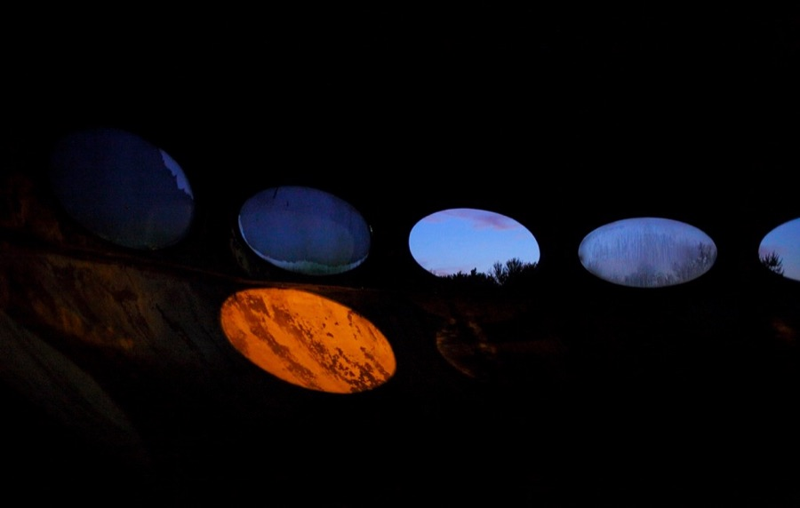
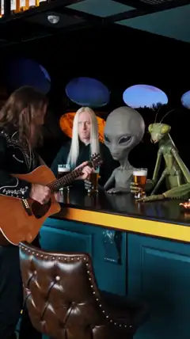

[← All skills](../../README.md)

# find-the-place-first

Ask Seedance for a place and it draws nobody's place: a kitchen that is every kitchen, a street that is a composite. Hand it a photograph of a real place and it keeps that place, its light, its clutter, where things stand. So the place is found first, and the scene is written to the photograph, never before it.

## Do this

1. **Read what place the request names,** in the maker's own words. A quality of the place ("dreamy", "abandoned") belongs in the search, because the photograph has to carry it. Never swap the maker's place for a neighbour of it.
2. **Search where people post photographs of that place,** and keep only real, candid ones: not AI-made, not stock, not posed or lit for a shoot.
3. **Check the photograph can hold the story:** the subject at a usable size, room for the action, and whatever the story needs in frame (a doorway to escape through, a counter to lean on).
4. **A place of two kinds** (a bar in a UFO) opens on the one a video model could least invent, the UFO, and puts the everyday one into it by its things: the counter, the stools, the beer. Find a photograph of each.
5. **Write the scene to the photograph.** Say where things stand in the frame, in the photograph's own terms ("at the bar where the row of oval porthole windows was"). Add the subject into what the camera already sees, and leave everything else as photographed.

## Example: "A man in a bar in a UFO"

*"A man in a bar in a ufo with nordics, tall greys, and mantids. The man plays a song on the guitar while the nordics, tall greys, and mantids drink beer and listen."*

| Found | | Video |
| --- | --- | --- |
| <br>**The UFO.** The inside of a flying-saucer house, a row of oval windows at dusk. The opening frame. | <br>**The bar.** A real counter with its stools, put into the saucer. | <a href="examples/ufo.mp4"></a> |

The first beat, as written. The bar stands "where the row of oval porthole windows was":

```
[0s] A man, dressed in black bohemian clothes, stands with a guitar at the bar
where the row of oval porthole windows was, before a tall, human-like Nordic
alien with long straight blonde hair, pale skin, and striking blue eyes, a tall
grey alien with a large bulbous head, oversized black almond-shaped eyes, and
a slender grey body, and a tall insectoid mantis alien with a triangular head,
large compound eyes, and segmented green limbs, each holding a glass of beer
at the counter.
```

Seedance kept the saucer's curved wall and its portholes, and put the bar's counter and stools beneath them.
