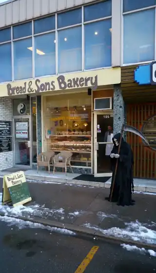

[← All skills](../../README.md)

# frame-zero

The photograph Seedance is handed is frame zero: the video starts from it. Seedance does not overturn what that photograph states. A script that asks for something the photograph contradicts gets a cut to a frame where that thing exists, and the take stops being one take.

## Do this

1. **The photograph is the first frame.** Write nothing that contradicts it.
2. **For each thing the story needs, ask what the photograph does with it.**
   - **It shows it.** Use it, by the name the photograph gives it.
   - **It permits it.** Off-frame is a real place at frame zero. A figure can walk in from the edge, and a person can be behind a closed door.
   - **It denies it.** An empty, made bed denies a sleeper. Put the thing in the first beat, so it is there from the first frame: arriving later, it contradicts the photograph and the video cuts. A crowd or a busy room is the exception. Find a photograph that already has one, because a written crowd reads as fake.
3. **The first beat describes frame zero:** the place as photographed, the things the action touches by the names the photograph gives them, and the subject already mid-action among them. Apart from what the first beat adds on purpose (the subject, and anything the photograph denies), every noun in it can be found in the photograph. Whatever else the photograph lacks waits for a later beat.
4. **Describe the photograph, never the device.** Write no "CCTV footage shows…" caption: the camera's look is already in the pixels. The device can still be a thing in the scene, as when a subject looks straight into its lens.
5. **Check that the opening action fits.** A place that reads is not enough: a body has to fit the spot and be able to move there.

## Example

### The grim reaper at a bakery

*"the grim reaper waiting his turn at a small bakery"*

| Found | Video |
| --- | --- |
| <br>**Frame zero.** A real bakery front on a snowy street. A passer-by in black walks past to the right of the door. | <a href="examples/reaper.mp4"></a> |

The first beat describes the photograph with both figures already in it. Every place it names, the sidewalk, the bakery entrance and the doorway, is in the photograph:

```
[0s] The Grim Reaper [skeleton · black hooded robe · scythe] stands on the
sidewalk to the right of the bakery entrance, looking down at a small paper
ticket in his hand, while a baker stands in the open doorway.
```

The video opens on the bakery as photographed and holds it for the whole take. The reaper stands where the passer-by was walking, and the passer-by, whom the script never mentions, is gone.

## Elsewhere in the skills

- **It permits:** in the doorbell raccoon under [stamp-the-beats](../stamp-the-beats/SKILL.md#the-doorbell-raccoon), the man is behind the door at frame zero. At 1 s, "the door at the right edge swings inward and the man steps into the frame".
- **By the photograph's own names:** the stand-in under [swap-the-stand-in](../swap-the-stand-in/SKILL.md#same-photograph-two-scripts) is named the way the photograph shows him, "the man in the grey t-shirt, blue jeans and red cap".
- **A place written onto the photograph:** the Oval Office under [catch-it-on-a-device](../catch-it-on-a-device/SKILL.md#the-oval-office-on-cctv) is written into an office camera's frame piece by piece, "where the long study desk with white cubicle dividers stood".
