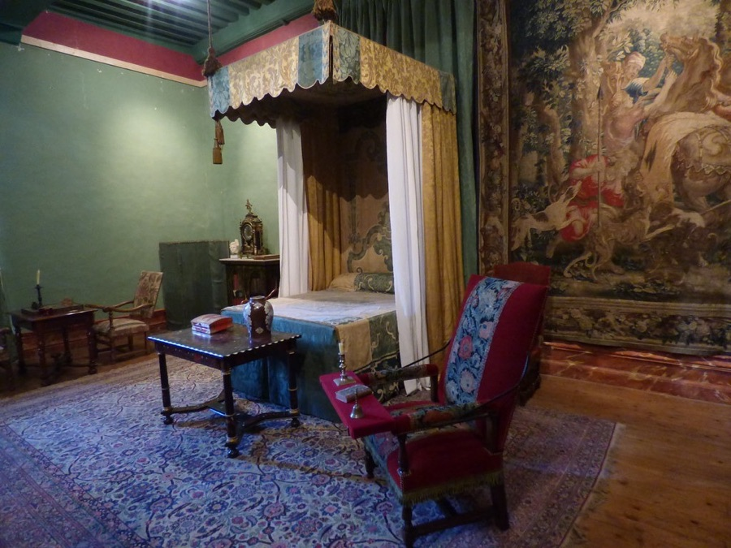

[← All skills](../../README.md)

# night-shots

A photograph of a figure at night is mostly dark. Seedance gets a silhouette, has nothing to animate, and invents the subject, then invents the frame around it. The place can still be real. Find the empty place and write the subject into it, with the night in the script: the torch, the moonlight, the streetlamp.

## Do this

1. **Never source the subject at night.** A dark photograph of the thing itself is worth less than none.
2. **Find the empty place.** It need not be photographed at night: the bedchamber below was found by day, and the script set the torch and the moonlight.
3. **A camera with its own light is the exception:** infrared, a flash, a porch light, headlights, a bodycam lamp. Then the place can be found at night, as that camera shows it, and the subject is written in.
4. **Write the light into the first beats,** by its source: what is lit, and by what.

## Examples

| Request | Found | Video |
| --- | --- | --- |
| *"cymbal monkeys roundup around a old medievel king's bed at night and smack cymbals in unison"* | <br>The bedchamber, found by day. The night is written. | <a href="examples/bedchamber.mp4"></a> |
| *"A badger plays a banjo on the grass at night and the neighborhood throws bottles and such for lack of enjoyment"* | <br>A front yard at night, from a security camera under a streetlamp: a camera with its own light. | <a href="examples/badger.mp4"></a> |

The night, written into the day photograph:

```
[0s] In a drafty medieval bedchamber, an elderly king sleeps soundly beneath
heavy crimson furs in a massive oak four-poster bed, where the palette is
dominated by deep reds, tarnished gold, and cold slate grey, and surrounding
the bed in a tight, menacing circle are twenty mechanical cymbal monkeys
standing with their brass cymbals poised.
[2s] The room is lit by a single guttering wall torch and a sliver of cold
moonlight hitting the stone floor as the king breathes slowly in his sleep.
```
