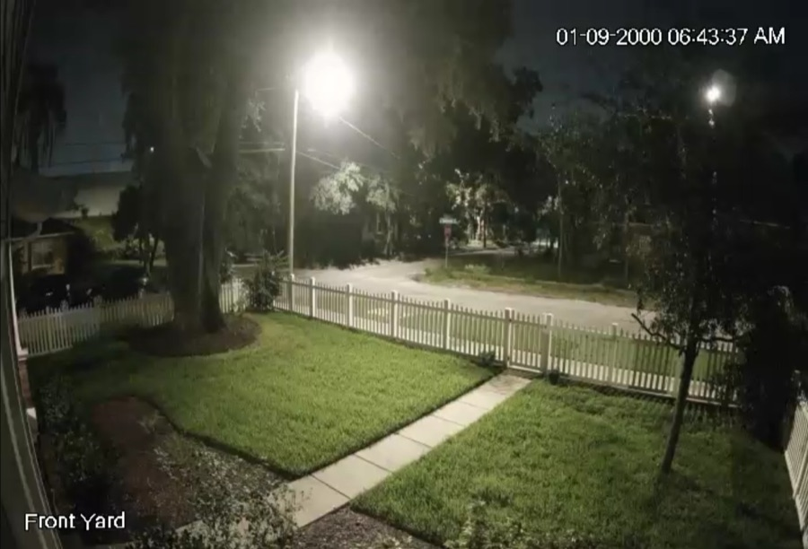
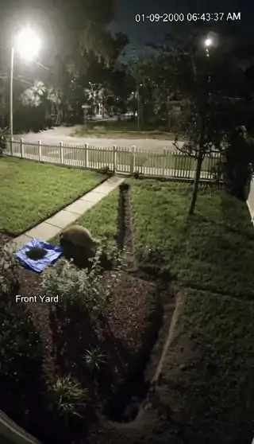

[← All skills](../../README.md)

# night-shots

A photograph of a figure at night is mostly dark. Seedance gets a silhouette, has nothing to animate, and invents the subject, then invents the frame around it. The place can still be real. Find the empty place as the camera sees it in the dark, and write the subject into it.

## Do this

1. **Never source the subject at night.** A dark photograph of the thing itself is worth less than none.
2. **Find the empty place in the dark,** the way a camera there sees it: the yard below, lit by its streetlamp.
3. **A camera with its own light is the exception:** infrared, a flash, a bodycam lamp, headlights. Then the place can be found at night as that camera shows it, and the subject written in.

## Example

### A badger in a dark yard

*"A badger digs up a lawn at 2am"*

| Found | Video |
| --- | --- |
| <br>**The place, empty.** A security camera's frame of a front yard in the dark, lit by a streetlamp, with its timestamp and the label "Front Yard". | <a href="examples/badger.mp4"></a> |

The badger did not come from a photograph: the only one is the empty yard. The script, as written:

```
[0s] The badger vigorously digs into the grass, throwing up dirt and sod.
```

The video holds the camera, the streetlamp, the timestamp and the label for the whole take.
