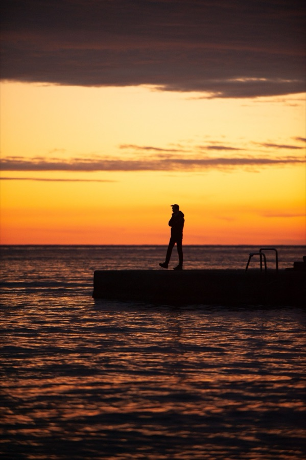
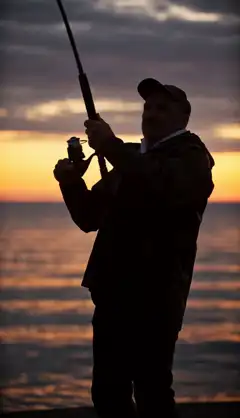

[← All skills](../../README.md)

# no-camera-directions

The photograph is the camera. Its angle, its lens, its distance from the subject are what Seedance starts from, and it holds them as long as the script lets it. A camera word in the script ("close on", "hard cut to", "the camera pans") asks for a frame the photograph never had, and Seedance obliges: it leaves the real place and draws one.

## Do this

1. **Write what happens, and where in the frame:** "at the right edge of the porch", "where the man in the bucket hat stood". Never how it is shot.
2. **No shot words:** no close-up, wide shot, pan, zoom, tilt, tracking shot, reveal, or "the camera".
3. **The capture is named once at most,** in the first beat, when the request names a device: "CCTV footage shows…". Then nothing more about the camera.
4. **A change of place is a second photograph.** Write the subject passing into it, and never cut to a place no photograph was found for.
5. **Read the draft for a sentence about the video rather than in it,** and strike it.

## What a camera word does

An early take, from before the rule.

*"a fisherman on a small wooden pier reeling in something heavy at dusk"*

| Found | Video |
| --- | --- |
|  | <a href="examples/fisherman.mp4"></a> |

```
[0s] A fisherman stands on the pier in place of the silhouetted person, reeling
in a heavy catch with a bent fishing rod.
[2s] The fisherman tugs the rod upward with both hands. Fisherman, to the water
[4s] Hard cut to the dark ocean depths: a massive anchor is hooked by the
fishing line, rising slowly.
[6s] The rising anchor snags on a rocky ledge, jerking the line taut.
[8s] Hard cut back to the pier: the fisherman is yanked forward, his boots
sliding along the concrete as he grips the straining rod.
```

The take opened on a close-up of the fisherman, a frame the photograph does not have. The "hard cut" at 4 s took it underwater to an anchor drawn from nothing. Only the last beat came back to the pier as photographed, from across the water.
