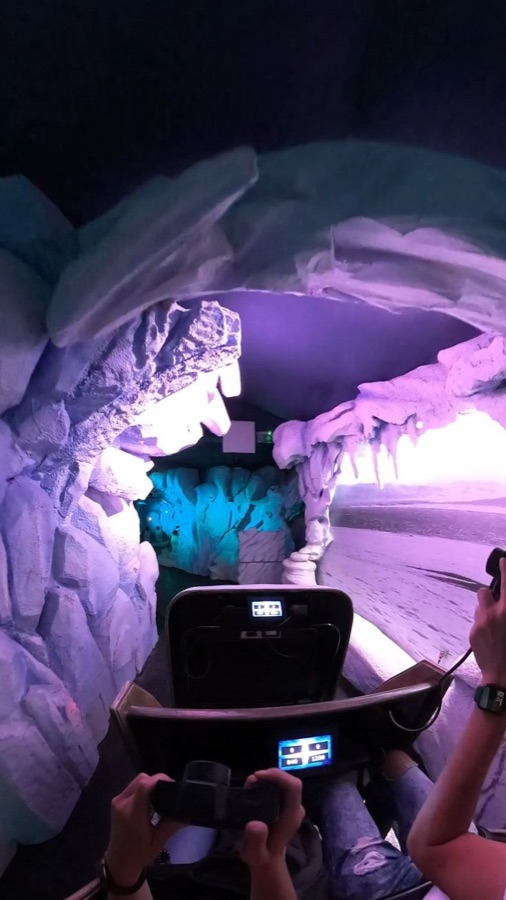
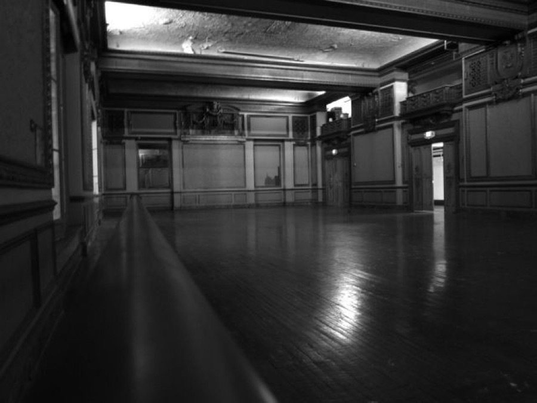
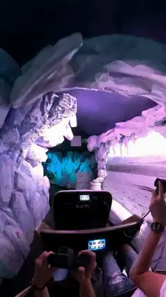

[← All skills](../../README.md)

# observation-or-plot

Not every video is a story. "A dark ride" is a view: the seat, the track, the rooms passing. "A bear chasing a man for his cereal" is a plot: it has to end somewhere. Writing a twist into a view breaks it, and writing a plot in flat beats wastes it. So the kind of take is decided first, from the words, and the beats are held to it.

## Do this

1. **Read the request for an event.** A thing that happens and pays off (he grabs the cereal, sees the camera, dances) is a plot. A place, a ride, a scene with people in it and nothing demanded of them is an observation.
2. **An observation:** two to four beats, the view held. Things move in it, nothing turns.
3. **A plot:** the beats build to one payoff, and the climax gets at least four seconds of the take. A climax cut short is a fault to fix before submitting.
4. **A bare noun is a view** unless the words ask for an event. Don't add drama the maker didn't ask for.

## Two takes, one of each

| | Found | Video |
| --- | --- | --- |
| **Observation.** *"liminal rollercoaster ride with haunted 1930's swing music, a bygone past themed ride. reflexivity in form and content"* |   | <a href="examples/ride.mp4"></a> |
| **Plot.** *"cctv footage of a bear chasing a man for his cereal. the bear ends up grabbing the cereal and sees the camera and starts celebrating with tiktok dances"* |  | <a href="examples/cctvbear.mp4"></a> |

The observation, three beats, a view held:

```
[0s] The rollercoaster ride glides through a bygone past themed dark ride, moving
along the rails of the artificial ice cave tunnel, past the restraint bar and the
hands holding the controllers toward a pair of wooden double doors.
[3s] The vehicle passes from the liminal empty corridor into a haunted 1930s
ballroom where haunted 1930s swing music plays throughout the interior as a
heavy mechanical click sounds from the track.
[6s] The ride reaches a reflexive turn, banking sharply to the left where the
track loops back toward the entrance, carrying the rollercoaster through the
swinging doors as the rails run on.
```

The plot, six beats, the payoff from 5 s:

```
[0s] CCTV footage shows a man sprinting through a suburban kitchen, followed
closely by a large bear.
[2s] The man drops a colorful cereal box as he escapes through a doorway.
[4s] The bear skids to a halt on the linoleum, and it snatches the box in its jaws.
[5s] Recognizing the lens of the overhead security camera, the bear looks
directly into it.
[6s] The bear stands on its hind legs while clutching the cereal.
[8s] The bear performs a series of recognizable TikTok dance moves.
```
