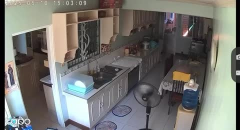
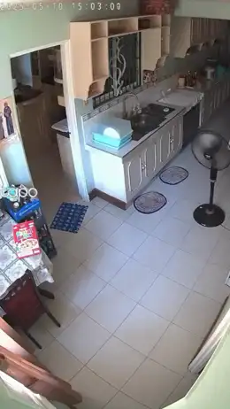

[← All skills](../../README.md)

# observation-or-plot

Not every video is a story. "A dark ride" is a view: the seat, the track, the rooms passing. "A bear chasing a man for his cereal" is a plot: it has to end somewhere. Writing a twist into a view breaks it, and writing a plot in flat beats wastes it. So the kind of take is decided first, from the words, and the beats are held to it.

## Do this

1. **Read the request for an event.** A thing that happens and pays off (he grabs the cereal, sees the camera, dances) is a plot. A place, a ride, a scene with figures in it and nothing demanded of them is an observation.
2. **An observation:** two or four beats, the view held. Things move in it, nothing turns.
3. **A plot:** three or six beats in a 9-second take, building to one payoff, and the climax gets at least four seconds. A climax cut short is a fault to fix before submitting.
4. **A bare noun is a view** unless the words ask for an event.

## Two takes, one of each

| | Found | Video |
| --- | --- | --- |
| **Observation.** *"the nihilistic penguin and punch monkey on trailcam footage in everest-like mountains"* |  | <a href="examples/trail.mp4"></a> |
| **Plot.** *"cctv footage of a bear chasing a man for his cereal. the bear ends up grabbing the cereal and sees the camera and starts celebrating with tiktok dances"* |  | <a href="examples/cctvbear.mp4"></a> |

The observation, four beats, a view held:

```
[0s] The environment is a harsh, high-altitude mountain range captured through
grainy trailcam footage, where Nihilist Penguin stands among the boulders facing
out toward the mountain while Punch the Monkey remains motionless beside it
clutching his stuffed orange orangutan toy.
[3s] Nihilist Penguin turns its head slowly toward the peak while a faint
mechanical whir sounds nearby.
[6s] Punch the Monkey's grip tightens slightly on the orangutan toy, but he is
otherwise unmoving.
[8s] Nihilist Penguin looks out and remains fixed on the distant mountain range,
its flippers held out at its sides.
```

The plot, six beats, the payoff from 5 s:

```
[0s] CCTV footage shows a man sprinting through a suburban kitchen, followed
closely by a large bear.
[2s] The man drops a colorful cereal box as he escapes through a doorway.
[4s] The bear skids to a halt on the linoleum, and it snatches the box in its jaws.
[5s] Recognizing the lens of the overhead security camera, the bear looks
directly into it.
[6s] The bear stands on its hind legs while clutching the cereal.
[8s] The bear performs a series of recognizable TikTok dance moves.
```
