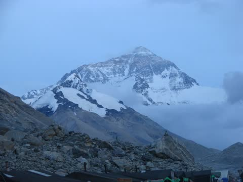
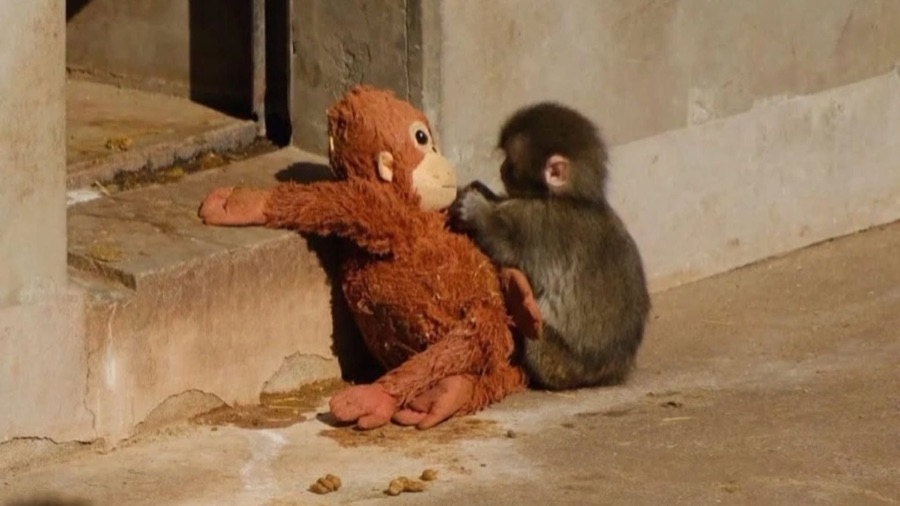
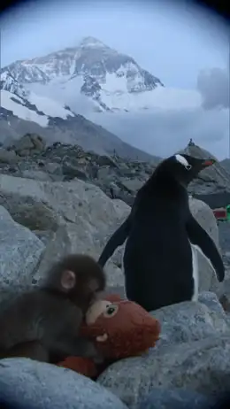
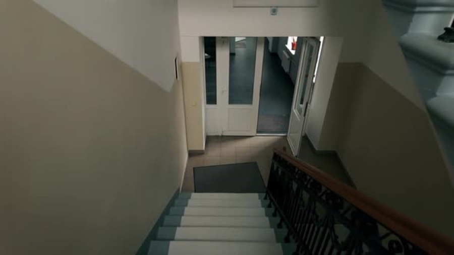
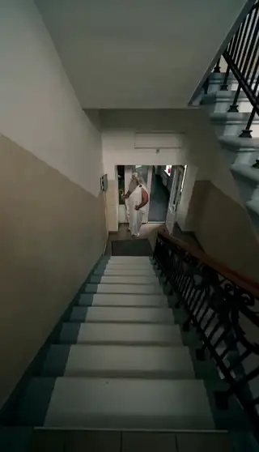

[← All skills](../../README.md)

# observation-or-plot

Not every video is a story. "A dark ride" is a view: the seat, the track, the rooms passing. "A bear chasing a man for his cereal" is a plot: it has to end somewhere. Writing a twist into a view breaks it, and writing a plot in flat beats wastes it. So the kind of take is decided first, from the words, and the beats are held to it.

## Do this

1. **Read the request for an event.** A thing that happens and pays off is a plot. A place, a ride, a scene with figures in it and nothing demanded of them is an observation.
2. **An observation:** two or four beats, the view held. Things move in it, nothing turns.
3. **A plot:** three beats, or six in a take of 9 seconds or more, building to one payoff. On a ride, the climax gets at least four seconds.
4. **A bare noun is a view** unless the words ask for an event.

## Examples

### Observation: two memes on a trail camera

*"the nihilistic penguin and punch monkey on trailcam footage in everest-like mountains"*

| Found | Video |
| --- | --- |
| <br>**The place.** A snowy peak.<br><br> <br>**The figures.** Two memes, so both were found as photographs (see [sort-the-characters](../sort-the-characters/SKILL.md)). | <a href="examples/trail.mp4"></a> |

The request asks for no event, and the plan recorded it as an observation. Four beats, a view held:

```
[0s] The environment is a harsh, high-altitude mountain range captured through
grainy trailcam footage, where Nihilist Penguin stands among the boulders facing
out toward the mountain while Punch the Monkey remains motionless beside it
clutching his stuffed orange orangutan toy.
[3s] Nihilist Penguin turns its head slowly toward the peak while a faint
mechanical whir sounds nearby.
[6s] Punch the Monkey's grip tightens slightly on the orangutan toy, but he is
otherwise unmoving.
[8s] Nihilist Penguin looks out and remains fixed on the distant mountain range,
its flippers held out at its sides.
```

### Plot: Zeus at a fuse box

*"zeus fixing a fuse box in an apartment stairwell"*

| Found | Video |
| --- | --- |
| <br>**The place.** An empty apartment stairwell. | <a href="examples/zeus.mp4"></a> |

The request asks for an event, a repair, and the take builds to it: three beats in 6 seconds, the payoff last.

```
[0s] Zeus [white beard · draped robe · lightning bolt] stands on the landing,
poking the open fuse box on the wall with the tip of his lightning bolt.
[3s] Zeus grumbles a low and taps a loose fuse inside the fuse box with his
finger.
[6s] Zeus presses the tip of his lightning bolt into the main switch, sending a
shower of sparks out of the fuse box.
```
