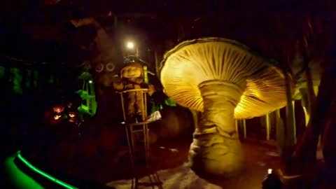
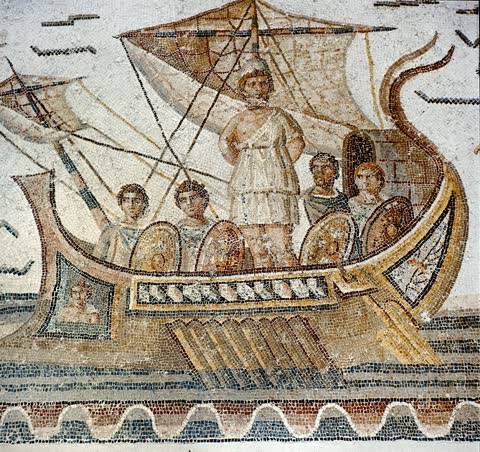
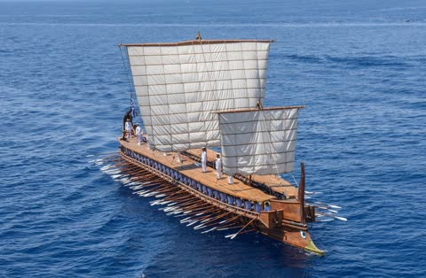

[← All skills](../../README.md)

# one-bag-of-four

Seedance conditions on every reference together. There is no "image 1 is the place, image 2 is the hero": it sees one set, and the script has to say what is what. Order was never shown to matter. So the bag is small and chosen: the place, the figures the script needs, and nothing that would read as a second place.

## Do this

1. **At most four references,** places and characters together.
2. **The place first,** the photograph the take opens on. Then the figures with photographs (see sort-the-characters), in the order the script needs them.
3. **One place in the bag,** unless the take passes into another. Two photographs of a place compete: in the haunted-ship ride under world-building-and-appropriation, a found mine scene won over the seat photograph, and the finished video never showed the seat.
4. **Say in the script what each reference is in the frame,** by what it shows, never by its position: "the giant mushroom on the right is a monumental sculpture group…". A `Set:` line is where a reference becomes a thing in the take.
5. **A thing with no reference is described,** and the description is its reference.

## Example: the Odyssey ride's four

*"The Odyssey ride"*

| | | | |
| --- | --- | --- | --- |
| <br>**The seat.** The place the take opens on. | <br>**The giant.** | <br>**The mast.** | <br>**The ship.** |

<p align="center"><a href="examples/odyssey.mp4"></a></p>

The `Set:` line that tells Seedance what each reference is in the frame:

```
Set: for the whole take, the giant mushroom on the right is a monumental
sculpture group depicting the blinding of Polyphemus; the character on the
high stand is a Roman mosaic depicting Odysseus tied to the mast of his ship;
the forest backdrop and trees on the far right is the show building's own
black wall; the ride's own omnimover (its nose and lap bar in the foreground,
the rows ahead) and the track bed stay as photographed; nothing of the
photograph's own set dressing remains, in any scene the ride passes.
```
