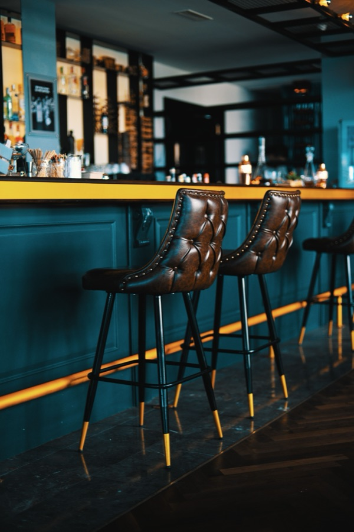
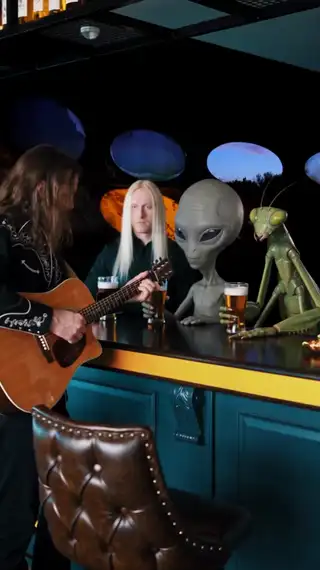

[← All skills](../../README.md)

# one-bag-of-four

Seedance conditions on every reference together. There is no "image 1 is the place, image 2 is the hero": it sees one set, and the script has to say what is what. Order was never shown to matter. So the bag is small and chosen: the place, the figures the script needs, and nothing that would read as another place.

## Do this

1. **At most four references,** places and characters together.
2. **The place first,** the photograph the take opens on. Then the figures with photographs (see [sort-the-characters](../sort-the-characters/SKILL.md)), in the order the script needs them.
3. **One place in the bag,** unless the take passes into another or puts one into another. Two photographs of a place compete: in the haunted-ship ride under [world-building-and-appropriation](../world-building-and-appropriation/SKILL.md#rides), a found mine scene won over the seat photograph, and the finished video never showed the seat.
4. **Say in the script what each reference is in the frame,** by what it shows.
5. **A thing with no reference is described,** and the description is its reference.

## Example

### The bar in the UFO

*"A man in a bar in a ufo with nordics, tall greys, and mantids. The man plays a song on the guitar while the nordics, tall greys, and mantids drink beer and listen."*

| The UFO | The bar | Video |
| --- | --- | --- |
| <br>A dark curved room with a row of oval porthole windows at dusk. The opening frame. | <br>A real bar counter with its stools. | <a href="examples/ufo.mp4"></a> |

Two photographs in one bag, and nothing in the bag says which is the room and which is the furniture. The script does: it puts the bar "where the row of oval porthole windows was". The first beat, as written:

```
[0s] A man, dressed in black bohemian clothes, stands with a guitar at the bar
where the row of oval porthole windows was, before a tall, human-like Nordic
alien with long straight blonde hair, pale skin, and striking blue eyes, a tall
grey alien with a large bulbous head, oversized black almond-shaped eyes, and
a slender grey body, and a tall insectoid mantis alien with a triangular head,
large compound eyes, and segmented green limbs, each holding a glass of beer
at the counter.
```

Seedance kept the curved wall and its portholes, and put the bar's counter and stools beneath them. The aliens had no photographs: they are described.
