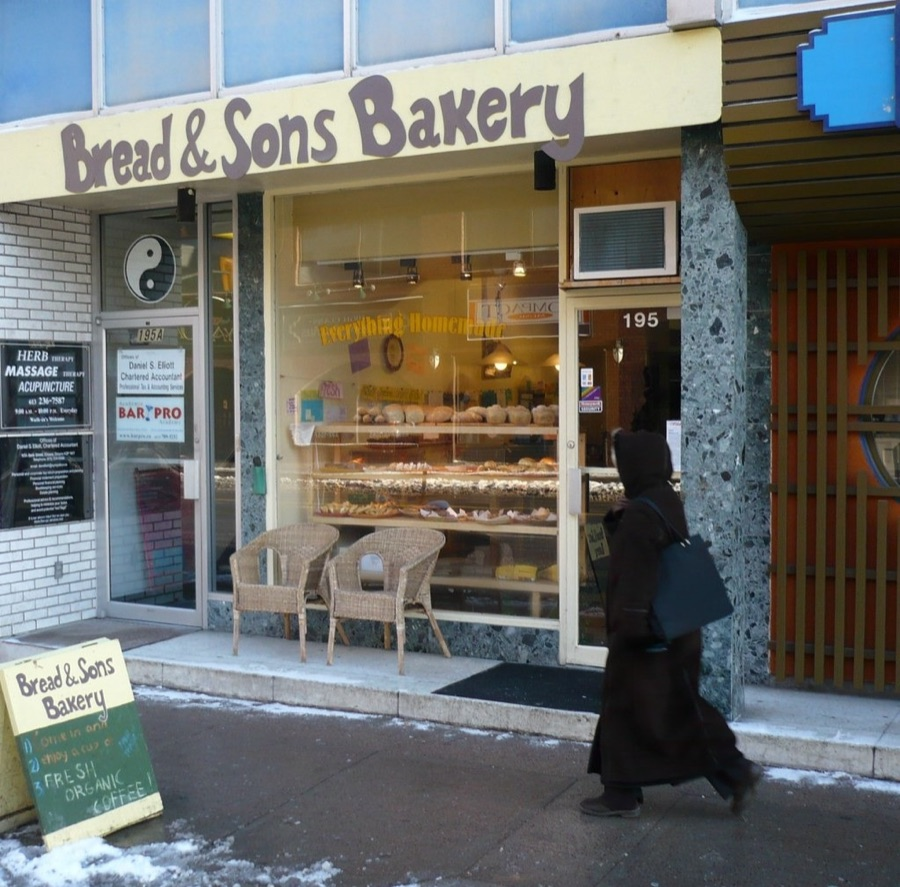
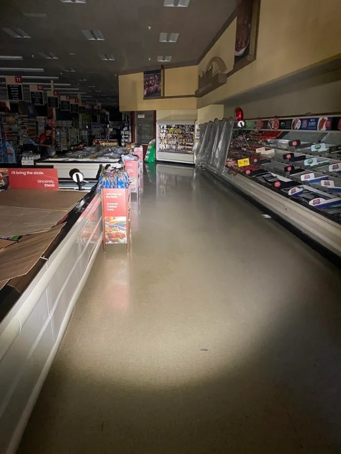
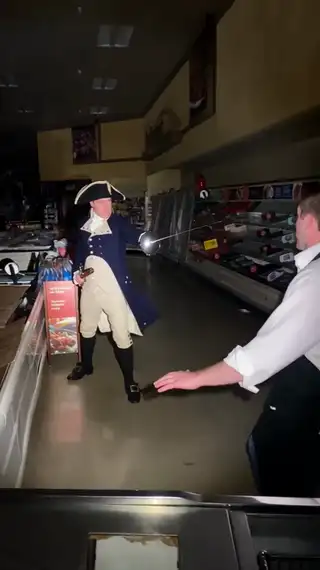

[← All skills](../../README.md)

⭐ **[frame-zero](../frame-zero/SKILL.md)** applies here, as it does to every skill.

# sort-the-characters

Seedance renders what it is shown and what it is told. A character with a photograph is shown. A character with no photograph, or one that must not be shown, is told: described by what they look like. And some names must not reach the model at all. So every name in the request is sorted before anything is searched.

## Do this

1. **A meme or a free character:** find its photograph. It goes in the bag of references with the place. Write it by its look, and give it its habits: what it carries, what it always does. The penguin and the monkey in the trail-camera take under [observation-or-plot](../observation-or-plot/SKILL.md#observation-two-memes-on-a-trail-camera) were both found as photographs.
2. **A figure from myth, folklore or a public-domain work:** name it, describe it, never search for it. The grim reaper and Redmond Barry below; Zeus under [observation-or-plot](../observation-or-plot/SKILL.md#plot-zeus-at-a-fuse-box).
3. **A famous person:** decline. A household name has no guise to write in its place.
4. **An owned character:** decline it when its identity is its design, like a cartoon's face. When it has a plain guise, like a Roman emperor in a toga, write the guise and never the name. The Lil Caesars mascot under [Remix](../../engine/remix.md#example-a-new-place-the-same-cast) went through this way, written as "a Roman emperor with a laurel wreath, wearing a toga, holding a spear". A name the model merely associates with a work is not in the request, and a named work, show or venue is not a character.
5. **Anyone else:** a nobody, described from the request ("a baker") and written into the beats.
6. **Keep the cast small.** The bag holds four references in all, the place included, so at most three characters come with photographs. The rest are described.

## Examples

### The grim reaper at a bakery

*"the grim reaper waiting his turn at a small bakery"*

| Found | Video |
| --- | --- |
| <br>**The place.** A real bakery front on a snowy street. A passer-by in black walks past to the right of the door. | <a href="examples/reaper.mp4"></a> |

Neither the reaper nor the baker came from a photograph: the only one is the bakery. The first beat, as written:

```
[0s] The Grim Reaper [skeleton · black hooded robe · scythe] stands on the
sidewalk to the right of the bakery entrance, looking down at a small paper
ticket in his hand, while a baker stands in the open doorway.
```

In the video the reaper stands where the photograph's passer-by was walking, and the passer-by is gone.

### Aisle Duel

*"Redmond Barry from Barry Lyndon is in a grocery aisle swordfighting a cashier."*

| Found | Video |
| --- | --- |
| <br>**The place.** A real grocery aisle in the dark, lit by a flashlight, with a shopper far down the store. | <a href="examples/duel.mp4"></a> |

Redmond Barry is the hero of Thackeray's 1844 novel. The script names him and describes him by his clothes, and describes the cashier. Neither came from a photograph: the only one is the aisle. The first beat, as written:

```
[0s] Redmond Barry from Barry Lyndon is in a grocery aisle swordfighting a
cashier while wearing a tricorn hat, a frock coat, breeches, and a cravat,
with a dueling pistol in his belt, as he stands pointing his sword at the
cashier behind the low display counter on the left.
```

The video keeps the dark aisle and the cases along it.
