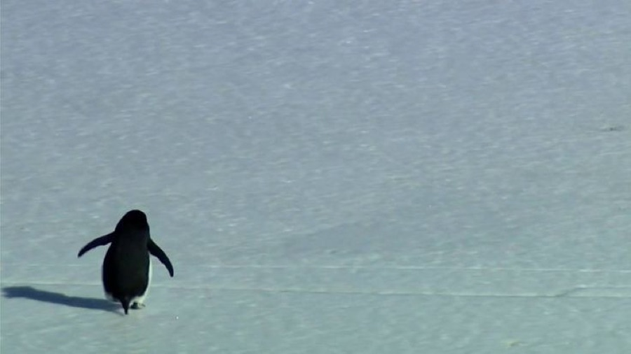

[← All skills](../../README.md)

# sort-the-characters

Seedance renders what it is shown and what it is told. A character with a photograph is shown. A character with no photograph, or one that must not be shown, is told: described by what they look like. And some names must not reach the model at all. So every name in the request is sorted before anything is searched.

## Do this

1. **A meme or a free character:** find its photograph. It goes in the bag of references with the place. Write it by its look, and give it its habits: what it carries, what it always does.
2. **A figure from myth, folklore or a public-domain work:** name it in the plan, describe it in the script, never search for it. The cyclops is "a massive cyclops with a highly muscular build… a single large blue eye" (see world-building-and-appropriation).
3. **A famous person or an owned character:** decline. A name the model merely associates with a work is not in the request, and a named work, show or venue is not a character.
4. **Anyone else:** a nobody, described from the request ("a man, dressed in black bohemian clothes") and written into the beats.
5. **Keep the cast small.** At most four characters from photographs, and the ones the maker named come before any the plan invented.

## Example: two memes on a trail camera

*"the nihilistic penguin and punch monkey on trailcam footage in everest-like mountains"*

| Found | | | Video |
| --- | --- | --- | --- |
| <br>**The penguin.** A meme, so its photograph is found. | <br>**Punch the Monkey.** A meme, so its photograph is found, with the plush it always carries. | <br>**The place.** | <a href="examples/trail.mp4"></a> |

The plan's note on the monkey, carried into the script: *attachment: a large, orange, long-legged stuffed orangutan plush toy; always: dragging his oversized plush toy everywhere, clutching it tightly while wandering or hiding.*

The first beat, as written:

```
[0s] The environment is a harsh, high-altitude mountain range captured through
grainy trailcam footage, where Nihilist Penguin stands among the boulders facing
out toward the mountain while Punch the Monkey remains motionless beside it
clutching his stuffed orange orangutan toy.
```
