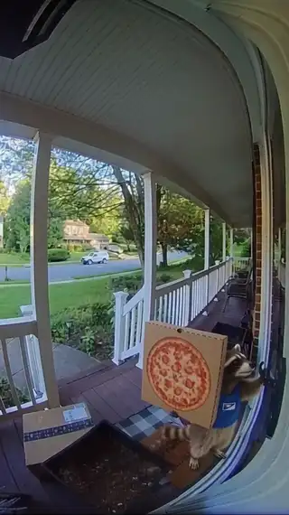

[← All skills](../../README.md)

# stamp-the-beats

Seedance reads time from the script. A script that lists events without seconds gets them spread out, run together or dropped. Stamped, each lands where it is written: the doorbell at 0 s, the door at 1 s, the line at 3 s, the shove at 5 s. The stamps are the edit.

## Do this

1. **One beat per event,** in order, each opening with its second in brackets: `[5s]`.
2. **Stamp the whole clip.** The first beat is `[0s]`; the last lands with time left for its action to finish. Most 9-second takes carry four to six beats; a view held gets fewer.
3. **A beat says what happens, not how it is shot.** See no-camera-directions.
4. **Dialogue gets its second** on its own line, with who speaks, to whom, and how: `Man to Raccoon (confused, annoyed) [3s]: "I didn't order anything."` A line lands on its beat.
5. **A payoff needs room.** Give the climax at least four seconds (see observation-or-plot).

## Example: the doorbell raccoon

*"doorbell cam: a raccoon in a tiny delivery vest rings the bell holding a pizza box. the guy opens the door and says "i didn't order anything" and the raccoon shoves the box into his hands, says "you did now" and sprints off with his wallet"*

| Found | Video |
| --- | --- |
|  | <a href="examples/doorbell.mp4"></a> |

The beats and the lines, as written:

```
[0s] The raccoon stands at the right edge of the porch in a tiny delivery vest,
pizza box balanced against one arm, and presses the doorbell button.
[1s] The door at the right edge swings inward and the man steps into the frame,
looking down at the raccoon.
[3s] The man plants his hands on his hips and stares at the pizza box.
[5s] The raccoon shoves the pizza box up into the man's chest, forcing his arms
to catch it.
[7s] The raccoon's paw darts to the man's back pocket and yanks out his wallet.
[8s] The raccoon vaults over the white railing, scrambles up the yard tree, and
sits on a branch pulling green bills out of the wallet.

Dialogue:
Man to Raccoon (confused, annoyed) [3s]: "I didn't order anything."
Raccoon to Man (raspy, triumphant) [5s]: "You did now!"
```
