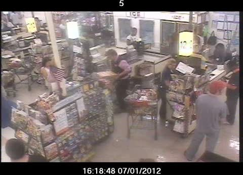
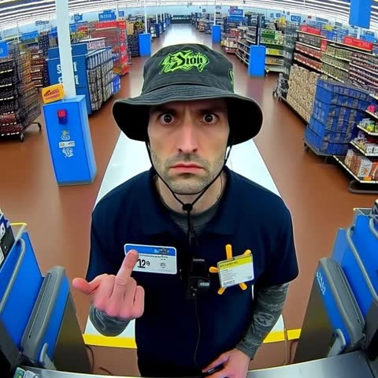
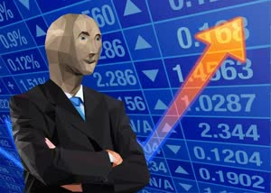

[← All skills](../../README.md)

# swap-the-stand-in

A real photograph of a place usually has people in it. That's part of why it looks real. When one of them stands exactly where the subject should be, that figure is a stand-in. Write the subject into the stand-in's place and Seedance keeps the photograph's composition: the subject stands at the right size for that spot, in the photograph's own light. When no one stands there, the subject is written into the place, and the people around it stay as scenery.

## Same request, two takes

*"cctv footage of Stonk meme stealing a whole rotisserie chicken from a supermarket deli and dragging it past the checkout…"*

| | Photograph found | Video |
| --- | --- | --- |
| **No stand-in.** Stonk is written in at the deli counter. The shoppers and the cashiers stay where the photograph had them. |  | <a href="examples/no-swap.mp4"></a> |
| **A stand-in.** A shopper stands square to the camera in the middle of the aisle. Stonk takes his exact place. |   | <a href="examples/swap.mp4"></a> |

The first beat of each script, as written:

```
[0s] At the supermarket deli counter, the figure (a bald, grey, featureless
mannequin head in a business suit with a stock chart background and an orange
upward arrow) grips the whole rotisserie chicken from the deli case with both
hands, while the man in the grey t-shirt, blue jeans and red cap stands with
his back to the counter near the nearest checkout lane.
```

```
[0s] The bald, neutral-faced figure in a suit stands at the checkout lane
where the man in the black bucket hat stood, arms crossed, dragging a whole
rotisserie chicken by its legs across the floor further along the lane, its
blank stare fixed toward the security camera above.
```

## Do this

1. **Search for a stand-in.** Look for a photograph of the place with something real already doing roughly what the subject will do. For a T-rex in a kitchen, the search was "dog chasing man in kitchen security camera footage". For a penguin on Everest, "snow leopard Mount Everest trailcam footage".
2. **Name the swap in the first beat,** using the photograph's own description of the stand-in: "stands … where the man in the black bucket hat stood". Seedance needs to know which figure becomes the subject.
3. **Start the subject on the stand-in's spot,** at the same distance from the camera. The action starts from there.
4. **Leave everyone else.** The other people in the photograph are scenery. Describe them as they are if the action passes them, like the man in the red cap above.
5. **No one in the spot?** Write the subject into the place directly, as in the first take.
