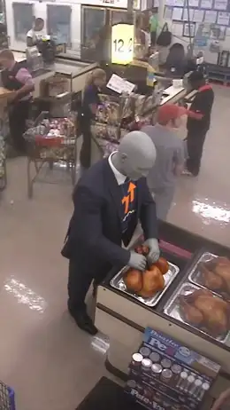
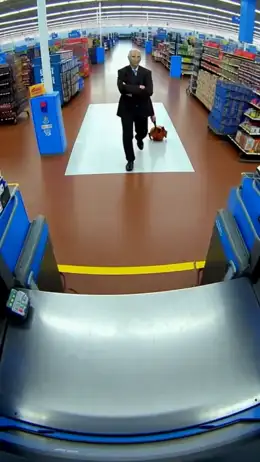

[← All skills](../../README.md)

# swap-the-stand-in

A real photograph of a place usually has people in it. That's part of why it looks real. When one of them stands where the subject should be, that figure is a stand-in. Write the subject into the stand-in's place, naming the stand-in, and the stand-in is gone from the video. Name a figure as staying, and it stays.

## Same photograph, two scripts

*"cctv footage of Stonk meme stealing a whole rotisserie chicken from a supermarket deli and dragging it past the checkout…"*

<p align="center"></p>

**The photograph found:** a convenience store from a high CCTV camera, with shoppers and cashiers. A man in a grey t-shirt and a red cap stands near the checkout. Both takes were made from this one photograph.

| Without a stand-in | With a stand-in |
| --- | --- |
| <a href="examples/no-swap.mp4"></a> | <a href="examples/swap.mp4"></a> |
| Stonk is written in at the deli counter, and the script keeps the man in the red cap where the photograph had him. He stays in the video. | The script puts Stonk where the man in the red cap stood. In the video the man is gone. Stonk starts at the deli tray close to the camera, and the rest of the store stays. |

The second take reused the first take's photograph, with the opening of its script rewritten for the swap. The first beat of each, as written:

```
[0s] At the supermarket deli counter, the figure — a bald, grey, featureless
mannequin head in a business suit with a stock chart background and an orange
upward arrow — grips the whole rotisserie chicken from the deli case with both
hands, while the man in the grey t-shirt, blue jeans and red cap stands with
his back to the counter near the nearest checkout lane.
```

```
[0s] Security camera footage of a supermarket checkout, seen from high on the
wall. The checkout lanes with their lit lane light, the candy racks at the
lane ends, the cashiers in pink shirts at their registers, the shopping carts,
the shoppers and the ICE freezer at the back wall stand as themselves, in
their places. The figure — a bald, grey, featureless mannequin head in a
business suit with a stock chart background and an orange upward arrow —
stands where the man in the grey t-shirt, blue jeans and red cap stood, near
the nearest checkout lane, and grips the whole rotisserie chicken from the
deli case with both hands.
```

## Do this

1. **Search for a stand-in first.** Look for a photograph of the place with something real already doing roughly what the subject will do. The engine's searches for a T-rex in a kitchen and a penguin on Everest were "dog chasing man in kitchen security camera footage" and "snow leopard Mount Everest trailcam footage". Neither take ended up with a stand-in: the T-rex kept the bear's kitchen, and the penguin's photograph is a bare peak. A candid photograph of the place often has someone in the spot anyway, like the man in the red cap.
2. **Name the swap in the first beat,** in the photograph's own description of the stand-in: "stands where the man in the grey t-shirt, blue jeans and red cap stood". Seedance needs to know which figure becomes the subject.
3. **Name the rest as staying.** The second script says everything else in the store stands "as themselves, in their places", and the store held. A take of the same script that opened without those two sentences drifted out of the store.
4. **Expect the stand-in gone, not the spot kept.** In the take above, Stonk started nearer the camera than the man stood.
5. **No one in the spot?** Write the subject into the place directly, as in the first take.
