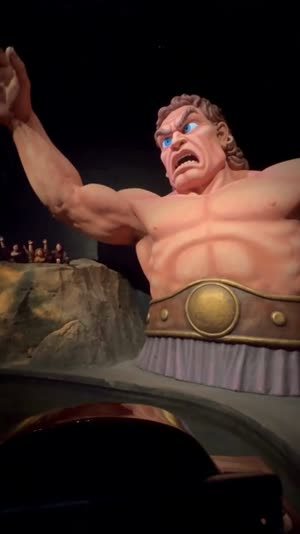
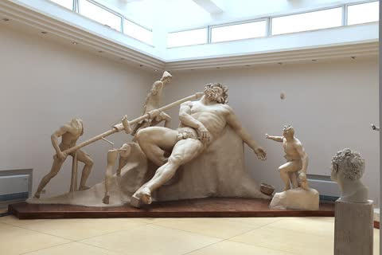
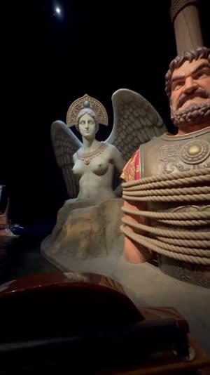
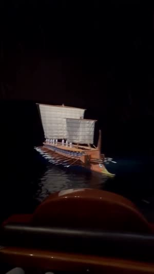
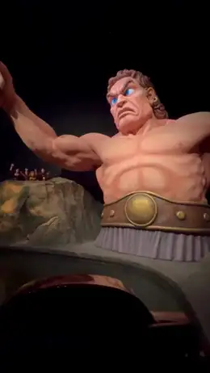
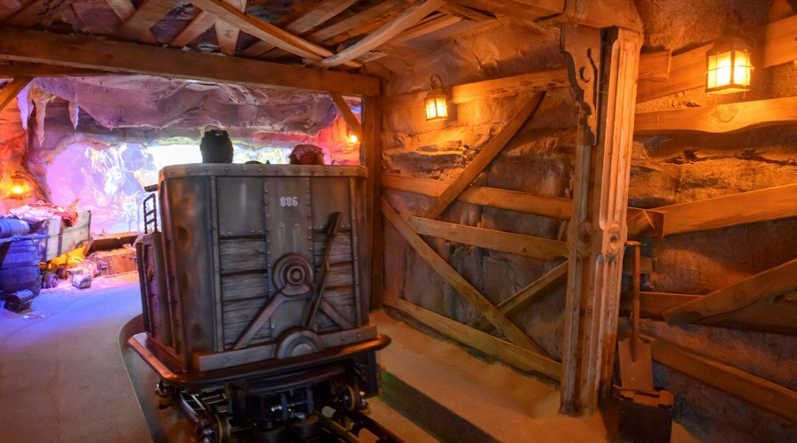

[← All skills](../../README.md)

# world-building-and-appropriation

Ask Seedance for "the Odyssey" and it makes a theme-park Greece: generic columns, a generic ship. The way in is the work's own material. A filmed work has its own scenes. A poem, a myth or a novel that was never filmed is still carried by real things: the statues, vases, mosaics and replica ships that people have made of it, which a camera has stood in front of.

## Do this

1. **Read what the name is:** a work, a place, a chain, a broadcast set. Each is searched differently.
2. **Hold the name.** Never broaden to a category. "A marine park" is not the request that was made.
3. **A filmed work:** its own scene is the plate. Its people can stay in the frame, because a figure the script never names does not render.
4. **A work that was never filmed:** find the real things that carry it. Search each as the object itself, such as "Polyphemus sculpture group", never as an illustration or a painting of it.
5. **A drawn work** is sourced as drawn. A cartoon has no photograph of itself.
6. **Map the work's things onto the photograph.** Say what each piece of the plate becomes, for the whole take, in a `Set:` line.

## Example: "The Odyssey ride"

Three words typed. The engine read *The Odyssey* as the poem, which has no frames of its own, so it found three real things that carry the poem and a real ride seat to put them in:

| Found | Became |
| --- | --- |
| <br>**The seat.** A rider's-seat frame from a forest dark ride. | <br>The opening frame. The giant stands where the mushroom stood. |
| <br>**The giant.** The Sperlonga sculpture group, the blinding of Polyphemus, with the wine bowl at his feet. | <br>The cyclops animatronic. |
| <br>**The mast.** The Bardo mosaic of Ulysses tied to the mast among the Sirens. | <br>Ulysses at the mast, a Siren on her rock. |
| <br>**The ship.** The Olympias, a rebuilt Athenian trireme. | <br>The galley crossing the dark water. |

<p align="center"><a href="examples/odyssey.mp4"></a></p>

The `Set:` line from the script, as written. It maps each set piece of the real ride photograph to a thing from the work:

```
Set: for the whole take, the giant mushroom on the right is a monumental
sculpture group depicting the blinding of Polyphemus; the character on the
high stand is a Roman mosaic depicting Odysseus tied to the mast of his ship;
the forest backdrop and trees on the far right is the show building's own
black wall; the ride's own omnimover (its nose and lap bar in the foreground,
the rows ahead) and the track bed stay as photographed; nothing of the
photograph's own set dressing remains, in any scene the ride passes.
```

Seedance rendered the sculpture and the mosaic as the ride's own animatronics. The characters on screen are described by what they look like, never by name: "a massive cyclops with a highly muscular build… a single large blue eye", "a winged, woman-faced creature… perched on a rock beside the mast".

## Rides

A ride is this skill from a seat. The request names a ride, so the opening frame is a real photograph from a rider's seat, found before anything else, and the world reaches the ride along the track.

- **A ride themed on a work:** the work's things take the seat photograph's own set pieces, as in the Odyssey example above, and the rest arrive along the track in story order.
- **A ride with no work named:** the seat photograph still carries the world, and the stops the request names are found as places of their own. Their things are mapped onto the seat photograph the same way. Figures no photograph exists for are described from the script.

*"A dark ride through a haunted cruise ship. The cart passes a drowned captain animatronic who croaks abandon ship. The cart rolls through a flooded ballroom where skeletons waltz. The ride ends in the engine room where a ghost engineer bangs a pipe and screams she's gonna blow as steam blasts the riders."*

| Found | Became |
| --- | --- |
| <br>**The seat.** The same rider's-seat photograph as the Odyssey. | <a href="examples/pirate-a.mp4"></a> |
| <br>**The stops.** No work is named, so the ballroom and the engine room were searched as places of their own. What came back was a scene from a ride designer's portfolio: a mine-themed dark ride, an ore cart under timber beams. | Its beams, lanterns and shovel took the seat photograph's set pieces, and the captain, the waltzing skeletons and the ghost engineer, who have no photograph to find, were described from the beats. |

The opening of the script, as written. The found scene's things stand where the seat photograph's own stood:

```
[0s] The omnimover glides forward along the track bed, its nose and lap bar at
the bottom of the frame, the rows ahead, past rough-hewn wooden mine support
beams where the forest scenery on the left and right walls stood [...] and
rolls on past a wooden-handled shovel prop where the giant mushroom on the
right stood toward glowing rustic metal lanterns where the character on the
high stand stood, and there, propped beside the shovel, a waterlogged, decaying
pirate captain animatronic in a tattered blue uniform, with glowing eyes and
seaweed draped over its shoulders turns its head toward the passing rows [...]
```
